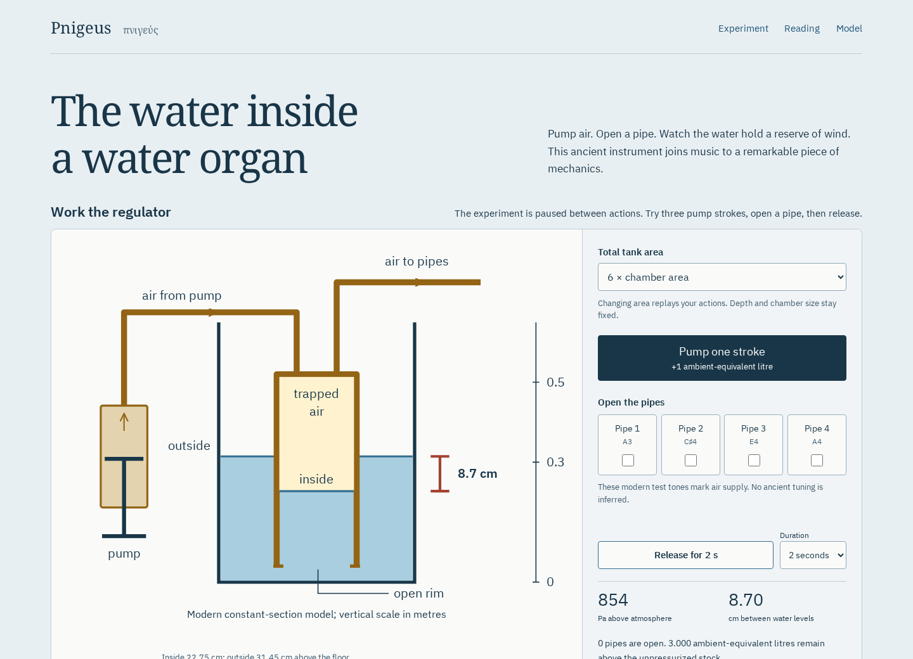

# Pnigeus

**Work the air regulator inside an ancient water organ.**

[](LICENSE)
[](https://antonsoo.github.io/pnigeus/)

A “water organ” can be misunderstood as a machine that sends water through
musical pipes. Hero and Vitruvius describe something more interesting: a pump
delivers **air** into an inverted chamber standing in water. The water holds
a reserve of wind for the pipes. Pnigeus makes that arrangement inspectable,
with an experiment, an original cutaway, a Latin reading and the source drawing.



[Open the live experiment](https://antonsoo.github.io/pnigeus/).
The [initial publication review](docs/publication.md) records the first pump
workshop edition. The [shape study review](docs/shapes-review.md) records the
expanded two-workshop edition separately.
The [saved illustrated reading](examples/one-pipe-reading.html), its
[printable PDF](examples/one-pipe-reading.pdf), and a
[five-second sound example](examples/one-pipe-release.wav) can be inspected locally.

## Start locally

Requires Node.js 24 or later. From this checkout:

```sh
npm ci
npm run dev
```

Open `http://127.0.0.1:4386/pnigeus/`. `npm run build` produces a complete static
site in `dist/`, with the base path `/pnigeus/`. Stop the development server
before running `npm run preview` on the same port. The app has no runtime
package dependencies, remote fonts, accounts or analytics.

## Try three experiments

1. **Store wind.** Pump three strokes with the pipes closed. Inside water drops
   to 22.746 cm and outside water rises to 31.451 cm. Their difference, 8.704 cm,
   supports about 854 Pa of gauge pressure. Releasing with all gates closed
   advances the experiment clock without consuming the reserve.
2. **Use the reserve.** Open pipe 1 and release for five seconds. Gauge pressure
   declines to about 410 Pa. Compare the separately sealed dry chamber: the
   same strokes produce a much larger initial pressure, which falls away
   sooner under the chosen outlet rule. The graph uses one pressure scale.
3. **Find the limit.** Choose the prepared rim-limit example. Inside water has
   reached the open rim. More strokes increase the vented-air total, rather
   than increasing pressure. No water disappears.

These figures are outputs of the documented modern model at tank area ratio 6,
not ancient measurements. Changing the tank area replays the same action order.
Undo and browser history restore that order, including gate changes at the same
experiment time. The chamber still contains air when its useful gauge pressure
reaches zero.

The experiment advances only when you issue a command. Pump strokes are
idealized instantaneous deliveries. “Release” advances the experiment clock
by two or five seconds. Pausing a tab does not consume experimental air.

## Explore the chamber’s shape

[Open the shape study](https://antonsoo.github.io/pnigeus/shapes.html).
Hero’s Greek instruction calls for a hollow hemisphere, turned upside down.
Read its eight-word clause beside the printed 1899 page, then compare that
form with a cylinder and a mathematical cone.

The second workshop asks a specific engineering question: **how much air can
a full chamber supply before pressure falls by a chosen percentage?** It varies
rim radius, initial fill and tank plan. An octagon around the rim circle leaves
water channels in its corners. Actual chamber space and gas measured at
atmospheric pressure stay in separate columns and downloads.

At the 80 cm diameter, roof-filled hemisphere preset, the calculations give:

| Quantity                           | Value                       |
| ---------------------------------- | --------------------------- |
| Full air space                     | 134.041 L                   |
| Full head                          | 652.816 mm water            |
| Full gauge pressure                | 6401.937 Pa                 |
| Space lost for a 30% pressure drop | 49.970 actual L             |
| Air supplied for that drop         | 54.721 ambient-equivalent L |

This reproduces the rounded geometric example discussed by Stefan Hagel
(2023), and adds a stated isothermal gas correction. The dimensions are a
scholarly reconstruction, not an ancient instrument’s measured pressure.
Halving the radius halves the head and divides geometric space by eight;
ambient gas stock has an additional pressure-dependent correction.

Vitruvius’s “inverted funnel” need not mean a cone: Roman funnels could be
rounded. The app treats the cone as a modern comparison. Footprint, height,
fill and tank area are held fixed, rather than claiming a universally optimal
form. The [full derivation](docs/shapes-model.md) states all constraints.

Each saved Greek reading embeds the complete source page, diagrams, fonts,
grammar notes and an exact CSV download. It opens and prints offline. Inspect
the [actual saved reading](examples/shape-reading.html), its
[PDF](examples/shape-reading.pdf) and [CSV](examples/shape-curves.csv).

## Read and keep the evidence

- Inspect the chamber, water, pump, open rim and pressure head in the cutaway.
  Phone layouts enlarge the reservoir detail and print both water levels beneath it.
- Read a short passage of Vitruvius X.8.2 in Latin and a new English translation.
  Select its phrases for grammar notes linked to the drawing. Three Greek
  headwords introduce the chamber, water and air without inventing pronunciation.
- Inspect figure 76 of Hero’s _Pneumatics_ in the 1851 Greenwood/Woodcroft edition.
  Follow links to the complete descriptions and the Latin edition.
- Copy an action-sequence URL, download the exact measurement CSV, or save a
  standalone HTML reading with its source image, fonts, grammar notes, full
  action table and last-release WAV embedded. It opens offline and prints.
- Play and stop the last release. Four explicitly modern sine test tones mark
  the available wind; live playback and PCM16 WAV use the same finite samples.
- Continue offline after the footer confirms the complete edition. The source
  drawing and fonts are checked against edition hashes before export. The
  service worker verifies the complete build before activating it.

## How the model works

The ancient texts provide the arrangement, not the numbers. The model uses a
constant-section chamber so water conservation and gas storage can be derived
directly. Hero describes a hemisphere; Vitruvius compares his chamber to a funnel.
Those wordings need not establish different forms. The shape study explains
that source distinction and keeps the cone as a modern comparison.

| Chosen parameter                       | Value                                      |
| -------------------------------------- | ------------------------------------------ |
| Chamber area                           | 0.04 m²                                    |
| Roof / rim / unpressurized water level | 0.52 / 0.04 / 0.30 m                       |
| Total tank area / chamber area         | 3, 6 or 12                                 |
| Initial air volume                     | 8.8 L                                      |
| Atmospheric pressure                   | 101325 Pa                                  |
| Water density / gravity                | 1000 kg/m³ / 9.80665 m/s²                  |
| Delivery per idealized stroke          | 1 ambient-equivalent L                     |
| Per-pipe outlet rule                   | 0.4 × √(gauge pressure / 1000) ambient L/s |

Let `d` be the drop of the inside surface from its unpressurized position, and
`R` the total tank area divided by chamber area. Water conservation gives:

```text
inside water  = 0.30 - d
outside water = 0.30 + d / (R - 1)
head          = d * R / (R - 1)
gauge pressure = density * gravity * head
actual air volume = 8.8 + 40d litres
```

The isothermal gas relation expresses the stock as ambient-equivalent litres:

```text
stock = actual air volume * (1 + gauge pressure / atmosphere)
      = initial stock + b*d + a*d²
```

Pumping inverts this quadratic using a root that avoids cancellation near zero.
Stock is capped when inside water reaches the rim; the surplus goes into a
separate vented-air account. A release solves the exact integral of the chosen
outlet law by bounded bisection. It stops at zero gauge pressure and accounts
for all withdrawn gas. No numerical time step is used in the application.

The [separate dry chamber](src/core/regulator.ts) starts with the same initial
air volume, receives the same stroke volumes and uses the same outlet rule,
but holds its volume fixed. It has no relief outlet. This is a counterfactual
comparison, rather than the ancient chamber with its water simply removed.
The [derivation](docs/model.md) gives the release equation and operating limits.

Pure logic lives in `src/core/`; drawing, controls, audio and file exports
consume it. Shared sessions hold at most 64 actions and reject ambiguous or
malformed state instead of replaying a valid-looking prefix.

## Verification

With the browsers already installed:

```sh
npm run check
npm run verify:physics
npm run test:browser -- /tmp/pnigeus-review/browser.json
python3 scripts/physics_oracle.py /tmp/pnigeus-review/browser.json
python3 scripts/audio-oracle.py /tmp/pnigeus-review/browser.json
```

On a new machine, first install Playwright’s browsers with
`npx playwright install --with-deps chromium firefox`. Python 3.12 or newer and
only its standard library are needed for the independent checks. The browser
script serves the existing build itself; do not rebuild `dist/` during its run.

With `npm run dev` running in another terminal, check the documented development
workflow with `node scripts/development-review.mjs`. It verifies actual CSS and
SVG styling, keyboard actions and standalone reading downloads in both engines
at both widths.

For the public site, the same browser reviewer accepts an HTTPS base URL:

```sh
node scripts/browser-review.mjs /tmp/pnigeus-review/hosted.json https://antonsoo.github.io/pnigeus/
python3 scripts/physics_oracle.py /tmp/pnigeus-review/hosted.json
python3 scripts/audio-oracle.py /tmp/pnigeus-review/hosted.json
```

Hosted offline checks disable browser networking; local checks additionally
close the origin server.

Check the shape study’s independent geometric solver and actual SVG/CSV:

```sh
npm run verify:shapes
npm run test:shapes -- /tmp/pnigeus-review/shapes.json
python3 scripts/shapes-oracle.py /tmp/pnigeus-review/shapes.json
```

For development, pass the running base URL and `development` as the final
argument to `scripts/shapes-browser.mjs`; for a hosted review, pass the public
HTTPS base URL. The shape checker integrates cross-sections with Simpson’s
rule and solves water conservation in pressure coordinates. It imports no
application code or cap-volume primitives. It also inspects the actual drawn
profiles, tank plans, water lines, curve vertices and downloaded CSV rows.

The physics checker imports no application code. It derives the gas volume
from pressure and water conservation, then integrates a pressure-coordinate
ODE with RK4. The app instead inverts an exact displacement-coordinate time
integral. It checks 168 model cases and independently checks actual browser
CSV output and the SVG path coordinates of both water surfaces.

The browser review exercises Chromium and Firefox at 1440 and 375 pixels,
keyboard controls, focus, history, source-word selection, accessibility,
real downloads, delayed audio cancellation, native saved readings and offline
reloads after the origin’s sockets close. The audio checker reconstructs every
sample of eight WAVs and eight captured live buffers, including the silence
after four open pipes exhaust the reserve. The [review](docs/review.md) records
the initial build, measured results and the limits of each check. The
[shape review](docs/shapes-review.md) records the expanded edition and both
workshops’ current regression checks.

## Accuracy and limitations

This is a source-grounded **teaching model**, not a reconstruction of a named
ancient organ. Dimensions, chamber shape, stroke size, outlet coefficient,
absolute pitches and sound colour are chosen. Water settles instantly and air
temperature stays fixed. Pump force, stroke duration, leakage, heat transfer,
fluid inertia, surface waves, pressure losses and actual pipe acoustics are
omitted. The water pressure is buffered, not held exactly constant.

The four sine pitches form a modern A-major test chord at A4 = 440 Hz.
Amplitude follows an illustrative pressure mapping; it is not a measurement of
organ loudness, ancient tuning, timbre or pressure-dependent pitch. Digital
sample agreement does not establish what a physical instrument or speaker does.

The texts and the 1851 illustration differ in date and evidential status. The
illustration is an editor’s explanatory diagram, not an ancient blueprint.
The Latin excerpt is a small reading exercise, not a complete critical edition.
External scholarly editions remain online links even when this exhibit is cached.
[Exact provenance, editions and rights](THIRD_PARTY.md).

## Contributing and license

New versions are released under the [PolyForm Noncommercial License 1.0.0](LICENSE). It is free for any noncommercial purpose, including personal study, teaching and research, and for use by charities, schools, universities, research organizations and government institutions. Commercial use needs written permission from Anthony Mercer (anthony@praviel.com). Versions up to commit [`c6addf6`](https://github.com/antonsoo/pnigeus/tree/c6addf6) (2026-11-01) were released under the MIT License, and copies of those versions keep it.

Corrections should identify the text, edition and passage, or the physical
assumption they change. Keep source evidence separate from model choices.
See [CONTRIBUTING.md](CONTRIBUTING.md).

Code, diagrams and new English explanations: [PolyForm Noncommercial 1.0.0](LICENSE), © 2026 Anthony Mercer.
The historical illustration and fonts retain their [separate notices](THIRD_PARTY.md).
