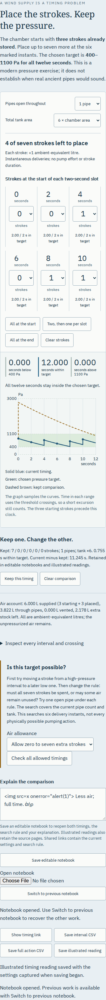

# Pnigeus: less air, a longer useful interval

Reviewed 2026-11-04. This audit extends the [first timing review](timing-review.md),
whose artifacts remain snapshots of implementation `54bb5f0`. Local numerical,
browser, source and publication evidence are distinct; publication is recorded
separately below when verified.

## Try the actual work

[Open the one-pipe timing exercise](https://antonsoo.github.io/pnigeus/timing.html?tank=6&pipes=1&strokes=7.0.0.0.0.0#timing).
Keep that timing. Check all allocations with **Use all seven extra strokes**.
Then choose **Allow zero to seven extra strokes**, search again and load a best
timing. Inspect the stroke budget, both traces and the air account.

| Tank ratio 6, one pipe | Allocations | Complete timings | Best time in target | Fewest extra strokes for a complete timing |
| ---------------------- | ----------: | ---------------: | ------------------: | -----------------------------------------: |
| Exactly seven strokes  |         792 |                0 |                10 s |                                       none |
| Zero to seven strokes  |       1,716 |               22 |                12 s |                                          3 |

One complete timing is `0 / 0 / 1 / 0 / 1 / 1`, at 0, 2, 4, 6, 8 and 10 seconds.
Only six ambient-equivalent litres are supplied including the three already
stored. Requiring all seven extra strokes can make an otherwise feasible target
fail: the surplus raises pressure and its pressure-dependent outflow. The
finite-domain result depends on both the physical assumptions and the search
constraint. It is not an ancient pumping instruction or an acoustic prediction.

The original equal-air question remains available: two pipes, tank ratio 6,
all seven early gives 3.678777 s, while `0 / 1 / 2 / 1 / 1 / 2` gives 12 s.
The [derivation](timing-model.md) states the model and its historical boundary.

Save an editable notebook, change the timing and explanation, then open the file.
Switch to the previous notebook: those intervening edits are retained too. Each
switch captures the outgoing notebook. This is one previous notebook in memory,
not unlimited history or automatic disk persistence. Save before reloading or
closing tabs. A notebook contains settings and learner text; an illustrated
reading additionally retains the source image, fonts and derivation.

[Actual editable notebook](../examples/notebooks/unused-air.json): both accounts,
search rule, explanation, edition and exact physical/exercise parameters. The
injection-shaped learner text deliberately exercises plain-text handling.
An invalid file or changed model assumptions cannot replace the account. A file
that finishes reading after further edits requires an explicit opening choice.
The script-free reading contains a native JSON link, so the notebook can also
be recovered from that file without running scripts.

## What the audit found and repaired

The [before receipt](audit/cache-before.json) reproduces a real defect in both
browsers: replacing a cached image with incorrect bytes left **Ready offline**
visible. Export correctly refused the image, but online reload served the same
bad cache, and there was no repair control. Presence was mistaken for identity.

The worker now checks decoded byte lengths, SHA-256, response URL and MIME
metadata. “Check offline copy” verifies the whole inventory. “Save offline copy
again” restores missing or damaged files while leaving open accounts and notes
alone. Damage discovered by one tab invalidates readiness in the other tabs.
Inspection after eviction does not create an empty cache and call it ready.
Controlled navigations use the verified edition. An unavailable or mismatched
file receives a 503 explanation, never an unverified replacement.

Updates wait for old tabs to close. Existing tabs keep their own edition and
can still save its verified sources. The footer explains the waiting edition;
it does not force a reload over unsaved work. The changed-source test uses a
separate synthetic fixture whose font notice contains a marker. That fixture
is never published. The old tab's export lacks the marker; the new export has
it only after old clients close and activation removes their obsolete cache.

Exports now stream into a bounded expected-size buffer. A stalled body fails
after 15 seconds without arriving bytes; a healthy transfer may continue for up
to three minutes. Offline install/repair has a five-minute overall bound and two
concurrent file transfers. All three rooms offer cancellation and retry. A
failed source cancels sibling font transfers. On uncontrolled pages a separate
network request prevents cancelled saves from joining a hanging lazy image;
controlled requests use their worker's verified edition, including in Firefox.

## Evidence and practical limits

The [independent numerical receipt](audit/timing-oracle.json) checks all 20,592
allocations across twelve tank/demand settings: 123,552 release intervals,
feasibility, best times and minimum complete stroke counts under both rules.
It integrates pressure coordinates with RK4 at 0.02 s and imports no application
solver. Maximum endpoint-pressure disagreement is below `1.1e-11 Pa`; maximum
interval-time disagreement is below `5.5e-7 s`. Agreement verifies the documented
modern model, not physical measurements.

Actual downloaded interval CSVs also pass that independent solver:
[equal-air](audit/timing-csv-oracle.json) and
[unused-air](audit/notebook-csv-oracle.json).

[Notebook browser operations](audit/notebook-browser.json),
[pump and audio](audit/pump-browser.json), and
[shape and Greek reading](audit/shapes-browser.json) cover Chromium and Firefox
at 1440 and 375 px. Operations include keyboard controls, real downloads,
source-page identity, native script-free reopening, account preservation,
accessibility checks and offline use. The notebook and timing tests stop the
real local origin before offline reload and export. The separate pump and shape
reviewers disable browser networking while their test servers remain running.
[Pump](audit/pump-oracle.json), [audio](audit/audio-oracle.json) and
[shape](audit/shapes-oracle.json) outputs retain their independent checks.

[Transfer receipt](audit/transfers.json): actual response bodies, no browser
route stubs. Both engines exercise idle failure, active slow export, grouped
failure cancellation, all-room cancellation/retry and a cold installation
sharing 64 KiB/s with a foreground illustrated export. An independent cache
walk checks every retained file's length and digest before the origin stops.
These rates are deliberately imposed audit conditions, not performance claims.

The complete recovery and waiting-update receipt is retained as
[offline recovery](audit/offline.json). It exercises same-length corruption,
missing scans, two-tab invalidation, refused corrupt offline export, total
cache eviction, selective repair, a slow active font repair, changed-source
waiting activation and export with the real origin stopped.

## Source review

Hero's [1851 description, section 76, pp. 105-107](https://www.gutenberg.org/cache/epub/77400/pg77400-images.html#Page_105)
and Vitruvius's [Latin X.8.2](https://www.gutenberg.org/cache/epub/51812/pg51812-images.html#vitruvius-para671)
were read again. The retained full Greek page (Schmidt 1899, printed p. 192)
was inspected directly. No ancient numeric pressure, pump cadence or tolerance
is inferred from these texts. Fresh [source-image downloads](audit/source-identities.json)
match both retained images byte for byte.

Hagel's 2023 _Inside the Hydra: Taking the Ancient Water Organ Seriously_
was checked through the [author-uploaded text](https://www.academia.edu/100416312/Inside_the_Hydra_Taking_the_Ancient_Water_Organ_Seriously); the publisher's PDF was inaccessible
in this review. Its idealized 80 cm geometric example explicitly ignores gas
compression. The app distinguishes actual space from its additional modern
isothermal gas correction. The cone remains a mathematical comparison, not a
claim that Vitruvius's inverted funnel must be conical.

A [combined-run timeout](audit/offline-timeout.json) is retained too. Firefox
once exceeded the reviewer's 120-second readiness wait during slow font repair.
That reviewer version did not capture enough state to establish the cause.
The full Firefox-only rerun and the repeated combined run both passed. The
reviewer now captures page/cache status on a subsequent failure. This remains an unexplained
intermittent observation, not a guaranteed completion-time bound. Install and
repair failures retain the open work and offer retry.
